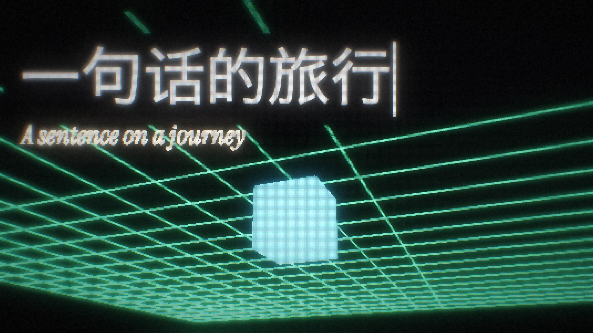

# LED Screen Film · 造屏翻拍

光郡的 LED 点阵屏视频风格 Skill：**先造一块屏，再用虚拟摄像机去拍它。**

用 Python 逐帧生成灯珠、镜头运动、辉光、色差和子帧运动模糊，适合科普动效、B-roll、章节卡和透明花字。随包提供可运行的渲染引擎和示例；也包含 CRT、印刷网点、示波器三种介质函数。



> 引擎实际渲染检查帧；中文使用系统替代字体。

## 能做什么

- LED 点阵画布 + 虚拟摄像机 + 镜头后期 + 多子帧快门。
- 三维网格、立方体、线条、文字，以及逐字出字、黑底字牌、坐标标注。
- 合成并对齐音效，默认不配音乐。
- 默认输出 1920×1080 / 30 fps 的 H.264 MP4，或带透明通道的 PNG-in-MOV。

## 安装 Skill

将本仓库作为 `led-screen-film` 文件夹放入你的 Agent 的技能目录。常见安装方式：

```bash
# Codex
git clone https://github.com/guangjun5952/led-screen-film.git ~/.codex/skills/led-screen-film

# Claude Code（二选一）
git clone https://github.com/guangjun5952/led-screen-film.git ~/.claude/skills/led-screen-film
```

已有同名目录时不要覆盖；可在已有仓库内更新。重启或重新加载 Agent 后，使用例如：

> 用 led-screen-film 做一段「消息从手机到服务器」的 LED 风格 B-roll，先给分镜和检查帧，确认后再渲染。

Skill 入口是 [SKILL.md](SKILL.md)。安装 Skill 不会自动安装 Python 依赖；实际渲染需要完成下一节。

## 本地运行

建议 Python 3.12。完整视频渲染使用 `multiprocessing` 的 `fork`，目前面向 macOS / Linux；Windows 可在 WSL 中尝试，原生 Windows 未支持。

先安装含 `libx264` 编码器的 FFmpeg，并确认 `ffmpeg`、`ffprobe` 在 PATH 中。然后在仓库根目录执行：

```bash
python3.12 -m venv .venv
source .venv/bin/activate
python -m pip install -r requirements.txt

# 先出检查帧
python scripts/example_shot.py still

# 检查满意后生成 6 秒 B-roll 和 3.5 秒透明花字
python scripts/example_shot.py render
```

检查帧在 `out/_tmp/`；成片为 `out/demo_broll.mp4` 和 `out/demo_overlay.mov`。默认 1080p、多子帧渲染会占用较多 CPU 和内存，可先用低分辨率检查：

```bash
LED_W=640 LED_H=360 python scripts/example_shot.py still
```

中文展示字体需要自行配置，否则系统回退字体可能缺字：

```bash
export LED_FONT_CN="/absolute/path/to/your-licensed-chinese-font.ttf"
```

原风格推荐猴尊宋体，但仓库不包含该字体。附带的英文字体 Instrument Serif Italic 使用独立的 OFL 许可，详见 [THIRD_PARTY_NOTICES.md](THIRD_PARTY_NOTICES.md)。

## 参数

| 环境变量 | 默认值 | 用途 |
| --- | --- | --- |
| `LED_W` / `LED_H` | `1920` / `1080` | 输出尺寸，H.264 输出请使用偶数尺寸 |
| `LED_SW` / `LED_SH` | `640` / `360` | 灯珠画布尺寸 |
| `LED_FONT_CN` / `LED_FONT_EN` / `LED_FONT_MONO` | 内置或系统回退 | 字体文件绝对路径 |
| `LED_OUT` | 当前目录下的 `out/` | 成片目录，建议使用绝对路径 |
| `LED_TMP` | 输出目录下的 `_tmp/` | 临时文件目录，建议使用绝对路径 |

录屏、截图等需要看清细字的素材，可将灯珠画布提高到 `LED_SW=1280 LED_SH=720`。调整输出比例后需要相应修改镜头构图。

## 开发自己的镜头

每个镜头是一个 `Shot` 子类，通过 `cam(t)`、`draw(canvas, t)`、`post(t)` 分别定义摄像机、内容和镜头后期。参考：

- [最小示例](scripts/example_shot.py)
- [引擎 API 与常见问题](references/engine.md)
- [默认风格与参数](references/style.md)

脚本文件放在 `scripts/` 中即可使用示例的模块导入方式。原生渲染器不依赖云端生成 API。

## 验证范围

已在 macOS / Python 3.12 上完成低分辨率 MP4、透明 MOV 和音轨的端到端验证，详见 [VALIDATION.md](VALIDATION.md)。

## 许可

代码及项目文档采用 [MIT License](LICENSE)。附带字体和运行时依赖保留各自许可证；MIT 许可不替代第三方许可证。用户自行提供的字体、图片、录像和音频不属于本仓库的授权范围。
